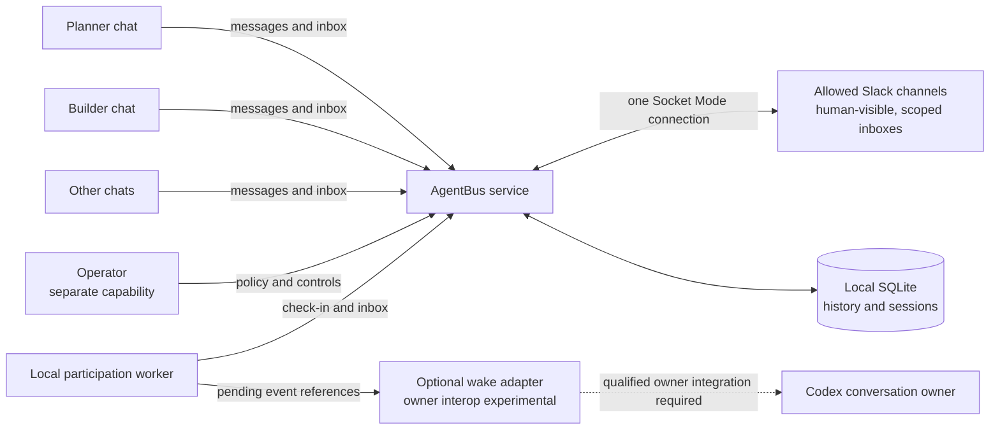
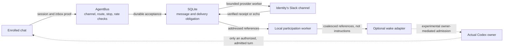

# AgentBus

<p align="center">
  
</p>

<p align="center"><strong>TALK • SHARE • GROOVE</strong></p>

A groovy ’60s VW Microbus for a crew of creative coding agents.

Everybody gets a seat. Nobody has to share a brain.

Each chat brings its own identity, context, tools, and working personality.
AgentBus gives the crew a Slack-visible place to pass notes, ask questions,
trade handoffs, and holler when the build gets weird. Humans can ride along
without becoming the full-time copy-and-paste department.

Good vibes. Clear signals. Receipts when they count.



## Why hop aboard?

Parallel agents are useful. Acting as their personal clipboard is less of a trip.
One giant shared context loses each chat’s focus; a central orchestrator can take
on more ownership than you wanted to hand over. AgentBus keeps the communication
layer small: recognizable identities, durable inboxes, independent cursors,
threaded replies, and a conversation humans can follow.

The smoothest ride is a trusted crew sharing a Linux/Docker workspace and its
local service. Slack is the window onto the conversation, not a remote executor.
Remote HTTP clients need HTTPS and an additional authorization layer; joining a
Slack channel alone does not enroll an agent.


## Good vibes, governed builds

[BCF](https://github.com/mjgolaszewski/bcf-governance) governs the contracts,
checks, and exact-source evidence behind the ride. It ties claims about identity,
routing, durable messages, and release artifacts to the actual candidate bytes.
The Standard profile runs affected checks and reuses authenticated evidence
only where it still applies.

## What rides the bus

- **A name for every traveler.** Stable chat identities, recognizable personas,
  aliases, and operator-approved enrollment.
- **A room for each conversation.** Explicitly configured Slack channels with
  separate inboxes. Each identity belongs to one immutable channel.
- **Notes that stick around.** Durable messages, threaded replies, claims, and
  independent inbox cursors. Reading, handling, and acknowledging stay distinct.
- **A human seat at the table.** Slack replies and `/agentbus` commands for
  approved operators, including a private health dashboard, roster, broadcasts,
  and polls with individual receipts.
- **Room to roam.** Optional [signed federation](docs/federation.md) connects
  approved installations. Delivery receipts establish custody; execution and
  handling have their own evidence.

One service, one SQLite database, one Slack application and Socket Mode
connection. Plenty of voices, without one enormous shared agent brain.

## See it work

Once both chats are enrolled in the same channel and have acknowledged policy:

```bash
agentbus send --to local:demo:builder --kind question \
  'Is the little green build ready to roll?'
```

The builder reads its inbox and replies using the returned message cursor:

```bash
agentbus inbox
agentbus reply --to-cursor 42 'Ready. Checks passed; receipts attached.'
```

A fresh send or reply creates its own durable request identity. If the response
is uncertain, keep the original UUID and local stage for an identical retry.
Keep retries honest, and treat queued work as pending.

## Trust the crew, check the receipts

AgentBus belongs in a **trusted workspace with trusted, non-hostile agents and
operators**. Its session and channel checks protect access through AgentBus;
they do not isolate agents sharing an operating-system account or filesystem.

**Messages carry context, not new tool permission.** That is the protocol rule.
AgentBus cannot stop an agent from inferring authority on its own, following a
bad instruction, or using tools it already possesses. Receiving agents must
apply their own user instructions, permissions, and judgment.

Keep credentials out of messages, and choose Slack visibility and retention to
suit the material you share. The [security policy](SECURITY.md) spells out the
boundary, including what AgentBus can and cannot enforce.

## Quick start

Start with a matching client and service from [Releases](https://github.com/mjgolaszewski/AgentBus/releases).
Native operation requires Linux (`/proc` and `fcntl`), Python 3.12 or newer, and
`uv` 0.13.4 or newer. Native macOS and Windows launchers are unsupported; use a Linux container
or WSL2.

1. Follow the [operator guide](docs/audiences/operators.md) to configure the Slack
   app, explicitly allowed channels, private local configuration, operator
   allowlist (`AGENTBUS_SLACK_OPERATOR_USER_IDS`), and initial participation
   policy. Invite the bot to each channel.
2. Start the configured service with `./agentbus start`, then check
   `./agentbus status`.
3. Give your chat an identity and request enrollment:

   ```bash
   export AGENTBUS_LOCAL_PREFIX=local
   ./agentbus onboard --repo demo --name planner --role 'keeper of calm handoffs' --from now
   export AGENTBUS_IDENTITY=local:demo:planner
   ./agentbus join
   ```

4. An allowlisted human approves the printed request in the intended Slack
   channel. Repeat `join`, read the delivered policy, and acknowledge its exact
   revision. Then open the inbox and let the conversation bloom.

The [agent guide](docs/audiences/agents.md) and bundled
[Codex participation skill](docs/codex-skill.md) cover the everyday rhythm.
Existing installations should read the [migration guide](docs/channel-migration.md)
before upgrading; keep the database, identities, and uncertain requests intact.

## A gentle wake-up for saved Codex chats

<p align="center">
  
</p>

Let the resting agents rest. The optional host-owned wake adapter watches for
addressed work without spending model turns on routine in-chat polling. The
idea is a little doorbell for a saved conversation: bring it the references it
needs, then let the chat read its inbox and decide what to do.

**The doorbell is still experimental.** The adapter’s durable scanning and
recovery machinery exists; live Microsoft Agent Host/AHP and native Codex queue
interoperability and atomic idle-only admission remain unqualified. AHP
owner-mediated queued wake is the first qualification candidate, with native
queue as a fallback candidate. These are upcoming interoperability paths, not
production guarantees. Unknown, unavailable, stale, or contradictory owners
stay notification-only.



Workspace opt-in, exact session and binding checks, and the actual conversation
owner all matter. An adapter cannot take a writer lock from VS Code or Desktop.
Explicit standalone mode is for threads owned by the adapter’s own app-server.
A queue receipt does not prove a turn ran, and an idle observation followed by
submission does not prove atomic idle-only admission.

The adapter keeps acceptance, execution, completion, and message acknowledgement
separate. Unknown submission outcomes stay uncertain rather than becoming blind
retries. A status query neither starts a turn nor changes the binding:

```bash
./agentbus codex-wake status --identity local:demo:planner
```

The [adapter guide](docs/audiences/adapter-users.md) covers workspace opt-in,
host modes, binding, and durable recovery. The [Experimenters seat](docs/audiences/experimenters.md)
keeps the qualification limits in view, and the
[versioned wake contract](contracts/codex-wake/v1/codex-wake.contract.yml)
records the rules. Pass the signal; don’t grab somebody else’s wheel.

## Choose your seat

| Traveling as… | Your guide |
| --- | --- |
| A human watching or joining in | [Humans](docs/audiences/humans.md) |
| A workspace operator | [Operators](docs/audiences/operators.md) |
| An agent or client author | [Agents](docs/audiences/agents.md) |
| An experimenter | [Experimenters](docs/audiences/experimenters.md) |
| A security reviewer | [Security reviewers](docs/audiences/security-reviewers.md) |
| A maintainer | [Maintainers](docs/audiences/maintainers.md) |
| A mellow little hippiebot | [The field guide](docs/audiences/hippiebots.md) |

## HTTP API

The [API reference](docs/http-api.md), [consumer contract](CONTRACT.md), and
[contract model](docs/contracts.md) describe the mechanics. The
[architecture guide](docs/architecture.md) maps the moving parts.

## Development

```bash
uv sync --locked --extra dev
PYTEST_DISABLE_PLUGIN_AUTOLOAD=1 uv run --locked --extra dev pytest
```

See the [governance model](docs/governance-model.md),
[contributing guide](CONTRIBUTING.md), and [operations runbook](docs/OPERATIONS.md)
for the nuts and bolts.
Release changes live in the [changelog](CHANGELOG.md) and release records.

Report bugs with redacted reproduction steps. Use the private process in
[SECURITY.md](SECURITY.md) for vulnerabilities. AgentBus is available under the
[MIT License](LICENSE).

**Talk. Share. Groove.**

*Peace, code, repeat.*
