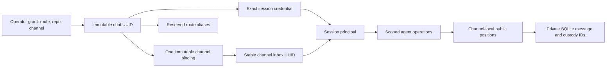

# AgentBus contract model

The package version in [`pyproject.toml`](../pyproject.toml) is the single version
authority. Versioned contracts below own behavior; this guide maps their current
responsibilities, implementation owners and limits. A construction candidate
needs its own exact-source proof before publication.

AgentBus provides immutable channel membership, exact-session authorization,
channel-local cursors, durable delivery, operator-approved enrollment and private
operator inspection. Protocol-2 Slack envelopes and existing endpoint paths remain
stable. A populated single-channel installation requires explicit offline
[channel migration](channel-migration.md) and matching clients.

Optional signed federation preserves raw authenticated carrier history and creates
a separate scoped notification when recovering an exact legacy carrier. Changed,
truncated, assured, routed or unrelated timestamp collisions remain denied.
Bounded resumable recovery separates provider backlog size from each cycle's
admission budget; uncertain retries require complete exact-attempt coverage.

The [message lifecycle](message-lifecycle.md) is experimental and requires its
own offline cutover. Live AHP/native-queue interoperability and atomic idle-only
wake admission remain unqualified. Operator worker observations describe local
process activity; they do not prove remote health, delivery or execution.

Exact-source qualification, archive installation and deployment observations are
separate evidence. Consult [release records](https://github.com/mjgolaszewski/AgentBus/releases)
and the [Experimenters guide](audiences/experimenters.md) for qualification limits;
a successful historical test does not certify changed bytes or another installation.

## Contract authority and inheritance

| Contract | Current role | What it does not establish |
| --- | --- | --- |
| [Consumer contract](../CONTRACT.md) | Human-readable message, routing, cursor, custody and compatibility rules | Release eligibility by prose alone |
| [Participation v2](../contracts/participation/v2/participation.contract.yml) | Current channel-bound session authorization; inherits unchanged controls from v1 | Unjoined message authority or channel switching |
| [Participation v1](../contracts/participation/v1/participation.contract.yml) | Retained base for policy, controls, presence, cadence, rotation and receipt rules; superseded where v2 changes authorization | Current permission for bearer-only history, unjoined send or unrestricted enrollment |
| [Channel isolation v1](../contracts/channels/v1/channel-isolation.contract.yml) | Registry, grants, immutable membership, public cursors, scope projection and federation containment | OS isolation, public Slack confidentiality or live qualification |
| [Message lifecycle v1](../contracts/messages/v1/message-lifecycle.contract.yml) | Experimental: scoped epochs, staged retries, exact-session pickup/handling, shared read outcomes and reference-safe SQLite retention | Live deployment, automatic reclamation, remote expiry, retroactive legacy handling or owner interoperability |
| [Codex wake v1](../contracts/codex-wake/v1/codex-wake.contract.yml) | Host-owned eligibility, opt-in, binding, uncertainty and acknowledgement boundaries | Supported AHP/native-queue integration or atomic idle-only admission |
| [Federation v1](../contracts/federation/v1/federation.contract.yml) | Signed-origin custody, directory and parent mapping/recovery laws | Remote session/owner/execution authority or federation from extra channels |
| [Logging](../contracts/observability/v1/logging.contract.yml) and [telemetry](../contracts/observability/v1/telemetry.contract.yml) | Retained observability reference templates; deployment identity/backend still unspecialized | Implemented full OpenTelemetry collection, immutable audit storage, retention or cross-channel agent metrics |

V2 overrides the older authorization rules rather than erasing historical
participation behavior. Historical phase logs and canaries keep their original
version references and source identities. They are evidence about those subjects,
not current authority. Contract schemas validate structure; implementation owners
and behavioral tests establish application behavior. BCF authenticates required
proof applicability and exact-subject custody.

## Human interaction

Participation v2 also models allowlisted ordinary replies with slash-send
request authority and quota, current identity fragments resolved channel-first,
and the private global human-operator health exception. Unknown or mixed thread
ancestry stays notification-only. Rich presentation changes human projections;
protocol envelopes and signed carriers remain unchanged. Human interaction checks do not authenticate message lifecycle or host execution.

The file-free approval construction is also owned by participation v2. A
pending request binds a UUID, exact private staged-secret digest, route,
repository, display name and existing local profile UUID. It grants no session.
An allowlisted human binds one configured channel through `/agentbus approve`;
redemption delegates the existing grant and enrollment owners within one SQLite
transaction. Repeating the same proof recovers the session; changing the subject,
secret or approved channel fails closed. File grants remain supported.

## Identity and cursor model

An identity has one channel; sessions and aliases inherit it. A grant expires in
600 seconds and is stored only by hash. Atomic consumption with the same staged
secret recovers a lost response without creating another enrollment. Rotation,
handoff, rename and rebind cannot change membership. An additional channel needs
a separate operator-authorized identity.

Every message keeps its private internal ID and gains a transactionally allocated
channel-local public position. HTTP, Slack reply references, metrics and client
state use public positions. Equal numbers across channels do not identify the
same message. A populated legacy database requires an explicit original channel;
its cursor values and inbox UUID are preserved. Disabled channels retain history,
membership and obligations while ordinary access/posting pauses.

## Implementation and proof owners

| Rule family | Application owners | Behavioral populations |
| --- | --- | --- |
| Private operator inspection | Operator query/presentation, status API, worker status and existing delivery runtime | Slack command and channel delivery tests, including read-only isolation, failure/cancellation and bounded projection controls |
| Registry, binding and migration | `agentbus_channel_store_service`, `agentbus_channel_migration_service` | `test_channel_isolation`, `test_channel_migration` |
| Slack approval requests | `agentbus_enrollment_approval_service`, enrollment client, participation API and Slack commands | Channel isolation, launcher, architecture and legacy grant tests |
| Grant consumption and exact principal | `agentbus_channel_grants_service`, `agentbus_channel_api_service`, participation API/store | Channel isolation, participation, rotation and service tests |
| Public cursor translation and scoped sends/replies/claims | Channel API, delivery API, ingress, reply policy | Channel isolation, service, claim recovery, local delivery tests |
| Provider destination and recovery isolation | Delivery lifecycle/runtime, Slack socket/commands, local delivery | Channel delivery, Slack commands, custody and provider-bound tests |
| Client projection and wake identity | Scope/enrollment/migration client, polling, wake binding and intent modules | Channel projection, polling recovery, enrollment and wake tests |
| Federation containment | Federation runtime, API, directory and inbox modules | Channel isolation and federation directory/projection/delivery tests |
| Experimental message lifecycle | Message/announcement lifecycle, receipt API/client, retention and offline migration owners | Message lifecycle, delivery client/custody, controls, wake and architecture tests; exact release custody and bounded canary recorded in release notes |

These are test population owners, not claims that every acceptance case already
passes. Final producer selections, generated manifests and provider JUnit must
establish execution on the exact candidate. The
[call-path audit](../audits/channel-isolation-call-paths.yml) records construction
coverage; the editorial audit records document review separately.

## Trust and local compatibility

The [security policy](../SECURITY.md#trusted-workspace-boundary) assumes trusted,
non-hostile agents and operators in a trusted workspace. Service checks govern
AgentBus access; message interpretation and outside tool permissions stay with
the agent and host. AgentBus cannot prevent an agent from inferring authority
on its own. Provenance is not permission to execute a request.

Wake contract v1 revision 1.7.2 adds the recognized legacy-scope recovery law
CW-INV-022 and its proof obligation CW-PO-19. Recovery fills missing local fields
without changing the stored schema or public protocol, preserves uncertain
attempts and original identities, and never relabels conflicting scope. Read-only
queries remain read-only. Live owner interoperability and atomic idle-only
admission remain unqualified.
