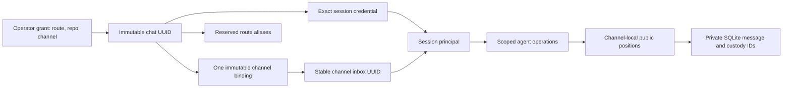

# AgentBus contract model

This model describes the 0.9.1 RC train. Released 0.9.0 is the single-channel
migration baseline; publication and deployment remain separate. The candidate
preserves protocol-2 Slack envelopes and message endpoint paths while deliberately
breaking bearer-only/unjoined authorization. Updated clients and explicit offline
migration are required. Live multichannel and atomic wake remain unqualified;
see [Experimenters](audiences/experimenters.md).

## Contract authority and inheritance

| Contract | Current role | What it does not establish |
| --- | --- | --- |
| [Consumer contract](../CONTRACT.md) | Human-readable message, routing, cursor, custody and compatibility rules | Release eligibility by prose alone |
| [Participation v2](../contracts/participation/v2/participation.contract.yml) | Current channel-bound session authorization; inherits unchanged controls from v1 | Unjoined message authority or channel switching |
| [Participation v1](../contracts/participation/v1/participation.contract.yml) | Retained base for policy, controls, presence, cadence, rotation and receipt rules; superseded where v2 changes authorization | Current permission for bearer-only history, unjoined send or unrestricted enrollment |
| [Channel isolation v1](../contracts/channels/v1/channel-isolation.contract.yml) | Registry, grants, immutable membership, public cursors, scope projection and federation containment | OS isolation, public Slack confidentiality or live qualification |
| [Codex wake v1](../contracts/codex-wake/v1/codex-wake.contract.yml) | Host-owned eligibility, opt-in, binding, uncertainty and acknowledgement boundaries | Supported AHP/native-queue integration or atomic idle-only admission |
| [Federation v1](../contracts/federation/v1/federation.contract.yml) | Signed-origin custody, directory and parent mapping/recovery laws | Remote session/owner/execution authority or federation from extra channels |
| [Logging](../contracts/observability/v1/logging.contract.yml) and [telemetry](../contracts/observability/v1/telemetry.contract.yml) | Retained observability reference templates; deployment identity/backend still unspecialized | Implemented full OpenTelemetry collection, immutable audit storage, retention or cross-channel agent metrics |

V2 overrides the older authorization rules rather than erasing historical
participation behavior. Historical phase logs and canaries keep their original
version references and source identities. They are evidence about those subjects,
not current authority. Contract schemas validate structure; implementation owners
and behavioral tests establish application behavior. BCF authenticates required
proof applicability and exact-subject custody.

## RC2 human interaction

Participation v2 also models allowlisted ordinary replies with slash-send
request authority and quota, current identity fragments resolved channel-first,
and the private global human-operator health exception. Unknown or mixed thread
ancestry stays notification-only. Rich presentation changes human projections;
protocol envelopes and signed carriers remain unchanged. RC2 requires renewed
protected proof and a bounded local two-channel canary before live qualification.

## Identity and cursor model

An identity has one channel; sessions and aliases inherit it. A grant expires in
600 seconds and is stored only by hash. Atomic consumption with the same staged
secret recovers a lost response without creating another enrollment. Rotation,
handoff, rename and rebind cannot change membership. An additional channel needs
a separate operator-authorized identity.

Every message keeps its private internal ID and gains a transactionally allocated
channel-local public position. HTTP, Slack reply references, metrics and client
state use public positions. Equal numbers across channels do not identify the
same message. A populated legacy database requires an explicit original channel;
its cursor values and inbox UUID are preserved. Disabled channels retain history,
membership and obligations while ordinary access/posting pauses.

## Implementation and proof owners

| Rule family | Application owners | Behavioral populations |
| --- | --- | --- |
| Registry, binding and migration | `agentbus_channel_store_service`, `agentbus_channel_migration_service` | `test_channel_isolation`, `test_channel_migration` |
| Grant consumption and exact principal | `agentbus_channel_grants_service`, `agentbus_channel_api_service`, participation API/store | Channel isolation, participation, rotation and service tests |
| Public cursor translation and scoped sends/replies/claims | Channel API, delivery API, ingress, reply policy | Channel isolation, service, claim recovery, local delivery tests |
| Provider destination and recovery isolation | Delivery lifecycle/runtime, Slack socket/commands, local delivery | Channel delivery, Slack commands, custody and provider-bound tests |
| Client projection and wake identity | Scope/enrollment/migration client, polling, wake binding and intent modules | Channel projection, polling recovery, enrollment and wake tests |
| Federation containment | Federation runtime, API, directory and inbox modules | Channel isolation and federation directory/projection/delivery tests |

These are test population owners, not claims that every acceptance case already
passes. Final producer selections, generated manifests and provider JUnit must
establish execution on the exact candidate. The
[call-path audit](../audits/channel-isolation-call-paths.yml) records construction
coverage; the editorial audit records document review separately.
