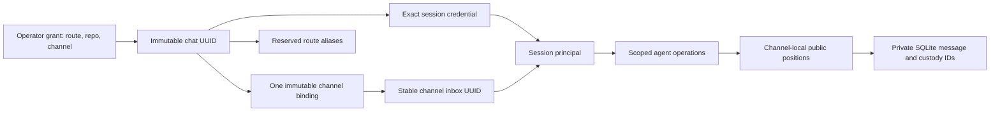

# AgentBus contract model

The package version in [`pyproject.toml`](../pyproject.toml) is the single
version authority; FastAPI and lockfile version literals are checked projections. This page is the derived release/capability guide; versioned
contracts below own behavior. A construction candidate requires its own exact-subject
proof before publication. Released experimental [RC6](https://github.com/mjgolaszewski/AgentBus/releases/tag/v0.9.1rc6),
subject `c5c7335`, passed protected PR/exact-main certification, reproducible archive
and SDK-free installation for bounded recovery and the bundled Codex skill; see
the [qualification record](../audits/rc6-recovery-skill.yml). It keeps the
100-event default and 1,000-event admission ceiling, with bounded resumable
reverse scans and oldest-prefix checkpointing rather than an all-backlog fit.
Uncertain retries require complete exact-attempt recovery coverage.

Released [RC5](https://github.com/mjgolaszewski/AgentBus/releases/tag/v0.9.1rc5)
closes [#94](https://github.com/mjgolaszewski/AgentBus/issues/94) at runtime subject
`ce31aa5` after protected PR/exact-main proof, reproducible archive and SDK-free
installation; its [qualification record](../audits/rc5-invariant-construction.yml)
retains older candidate evidence under its own subjects. Deployment observations
are separate from source qualification and never imply execution or semantic ACK.
Released RC4 (`6a1c672`) also has protected, archive/install and bounded two-channel
evidence. RC7 raw-carrier recovery is a construction candidate pending its own
protected-source, archive and installation proof.

Protocol-2 Slack envelopes and endpoint paths stay stable. Updated clients and
explicit offline migration are required from released 0.9.0; RC5 and RC6 add no
database migration. Every candidate requires its own protected proof and archive
installation; publication and deployment are separate actions. Live AHP/native-queue
interoperability and atomic idle-only admission remain unqualified (#75).

Private RC4 `health`, `workers`, `doctor`, channel-scoped `pending [ID]` and
`explain CURSOR` observe existing tasks/cycles. They reset on restart and do not
establish external poll/wake health or remote execution. RC5 corrects delivery
progress/expiry, control projection priority, alias presentation and assurance;
see the [construction audit](../audits/rc5-invariant-construction.yml).

## Contract authority and inheritance

| Contract | Current role | What it does not establish |
| --- | --- | --- |
| [Consumer contract](../CONTRACT.md) | Human-readable message, routing, cursor, custody and compatibility rules | Release eligibility by prose alone |
| [Participation v2](../contracts/participation/v2/participation.contract.yml) | Current channel-bound session authorization; inherits unchanged controls from v1 | Unjoined message authority or channel switching |
| [Participation v1](../contracts/participation/v1/participation.contract.yml) | Retained base for policy, controls, presence, cadence, rotation and receipt rules; superseded where v2 changes authorization | Current permission for bearer-only history, unjoined send or unrestricted enrollment |
| [Channel isolation v1](../contracts/channels/v1/channel-isolation.contract.yml) | Registry, grants, immutable membership, public cursors, scope projection and federation containment | OS isolation, public Slack confidentiality or live qualification |
| [Message lifecycle v1](../contracts/messages/v1/message-lifecycle.contract.yml) | Experimental released RC3: scoped epochs, staged retries, exact-session pickup/handling, shared read outcomes and reference-safe SQLite retention | Live deployment, automatic reclamation, remote expiry, retroactive legacy handling or owner interoperability |
| [Codex wake v1](../contracts/codex-wake/v1/codex-wake.contract.yml) | Host-owned eligibility, opt-in, binding, uncertainty and acknowledgement boundaries | Supported AHP/native-queue integration or atomic idle-only admission |
| [Federation v1](../contracts/federation/v1/federation.contract.yml) | Signed-origin custody, directory and parent mapping/recovery laws | Remote session/owner/execution authority or federation from extra channels |
| [Logging](../contracts/observability/v1/logging.contract.yml) and [telemetry](../contracts/observability/v1/telemetry.contract.yml) | Retained observability reference templates; deployment identity/backend still unspecialized | Implemented full OpenTelemetry collection, immutable audit storage, retention or cross-channel agent metrics |

V2 overrides the older authorization rules rather than erasing historical
participation behavior. Historical phase logs and canaries keep their original
version references and source identities. They are evidence about those subjects,
not current authority. Contract schemas validate structure; implementation owners
and behavioral tests establish application behavior. BCF authenticates required
proof applicability and exact-subject custody.

## RC2 human interaction

Participation v2 also models allowlisted ordinary replies with slash-send
request authority and quota, current identity fragments resolved channel-first,
and the private global human-operator health exception. Unknown or mixed thread
ancestry stays notification-only. Rich presentation changes human projections;
protocol envelopes and signed carriers remain unchanged. Historical RC2 proof
and bounded human checks do not authenticate later RC3 lifecycle changes.

The file-free approval construction is also owned by participation v2. A
pending request binds a UUID, exact private staged-secret digest, route,
repository, display name and existing local profile UUID. It grants no session.
An allowlisted human binds one configured channel through `/agentbus approve`;
redemption delegates the existing grant and enrollment owners within one SQLite
transaction. Repeating the same proof recovers the session; changing the subject,
secret or approved channel fails closed. File grants remain supported.

## Identity and cursor model

An identity has one channel; sessions and aliases inherit it. A grant expires in
600 seconds and is stored only by hash. Atomic consumption with the same staged
secret recovers a lost response without creating another enrollment. Rotation,
handoff, rename and rebind cannot change membership. An additional channel needs
a separate operator-authorized identity.

Every message keeps its private internal ID and gains a transactionally allocated
channel-local public position. HTTP, Slack reply references, metrics and client
state use public positions. Equal numbers across channels do not identify the
same message. A populated legacy database requires an explicit original channel;
its cursor values and inbox UUID are preserved. Disabled channels retain history,
membership and obligations while ordinary access/posting pauses.

## Implementation and proof owners

| Rule family | Application owners | Behavioral populations |
| --- | --- | --- |
| RC4 private inspection | Operator query/presentation, status API, worker status and existing delivery runtime | Slack command and channel delivery tests, including read-only isolation, failure/cancellation and bounded projection controls |
| Registry, binding and migration | `agentbus_channel_store_service`, `agentbus_channel_migration_service` | `test_channel_isolation`, `test_channel_migration` |
| Slack approval requests | `agentbus_enrollment_approval_service`, enrollment client, participation API and Slack commands | Channel isolation, launcher, architecture and legacy grant tests |
| Grant consumption and exact principal | `agentbus_channel_grants_service`, `agentbus_channel_api_service`, participation API/store | Channel isolation, participation, rotation and service tests |
| Public cursor translation and scoped sends/replies/claims | Channel API, delivery API, ingress, reply policy | Channel isolation, service, claim recovery, local delivery tests |
| Provider destination and recovery isolation | Delivery lifecycle/runtime, Slack socket/commands, local delivery | Channel delivery, Slack commands, custody and provider-bound tests |
| Client projection and wake identity | Scope/enrollment/migration client, polling, wake binding and intent modules | Channel projection, polling recovery, enrollment and wake tests |
| Federation containment | Federation runtime, API, directory and inbox modules | Channel isolation and federation directory/projection/delivery tests |
| RC3 lifecycle construction | Message/announcement lifecycle, receipt API/client, retention and offline migration owners | Message lifecycle, delivery client/custody, controls, wake and architecture tests; exact release custody and bounded canary recorded in release notes |

These are test population owners, not claims that every acceptance case already
passes. Final producer selections, generated manifests and provider JUnit must
establish execution on the exact candidate. The
[call-path audit](../audits/channel-isolation-call-paths.yml) records construction
coverage; the editorial audit records document review separately.
