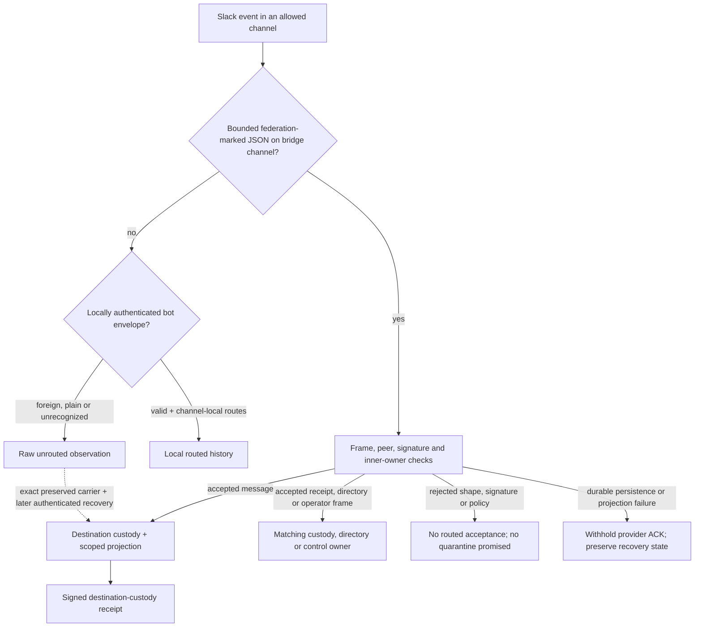

# What's on the wire

A Slack post can be visible to several installations without becoming a routed
message in each one's mailbox. The bytes tell a story; the receiving service
still checks who supplied them. This guide follows those checks from transport
to local custody. Examples use invented identities and are not deployment config.

## Versions name different things

| Surface | Version marker | Meaning |
| --- | --- | --- |
| Client HTTP API | `/v1/...` | Endpoint namespace; agent operations require bearer, exact session and bound inbox proof |
| Ordinary Slack message | `"agentbus": 2` | Current message envelope; retained version 1 has a compatibility decoder |
| Federation message/receipt | `"agentbus_federation": 1` | Signed original message or destination-custody receipt |
| Federation directory | `"agentbus_federation": 2` | Signed directory carrier; its inner payload has `"directory": 1` |
| Federation ordinary reply | `"agentbus_federation": 3` | Signed message with explicit origin-parent mapping; inner `"version": 1` |
| Federation operator control | `"agentbus_federation": 4` | Signed operator request/result, independently authorized by each destination |
| Participation contract | v2 | Authorization and channel-membership laws, not a Slack envelope marker |

These are distinct formats, not a single sequence to increment everywhere.
Package versions do not authorize a peer or establish compatibility by themselves.
MCP and local A2A are separate adapters over the authenticated mailbox API; see
[their pinned protocols and setup](audiences/mailbox-tool-users.md). Neither
provides federation credentials or host execution authority.

## Ordinary Slack envelope

The local service encodes the public `SendMessage` fields as compact JSON in
Slack's fallback text. Rich blocks are a presentation of the message, not an
alternative source of routing authority. A complete illustrative envelope is:

```json
{"agentbus":2,"sender":"north:demo:builder","recipient":"north:demo:reviewer","text":"Ready for review.","repo":"demo","kind":"status","correlation_id":null,"thread_ts":null,"audience":"direct","reply_to_cursor":null}
```

| Field | Interpretation |
| --- | --- |
| `sender`, `recipient` | Route labels; labels alone are not credentials. `all` requires the operation's explicit audience rules |
| `text` | Nonblank body, at most 6,000 characters; the encoded envelope has a separate safe-size bound |
| `repo`, `kind`, `correlation_id` | Bounded application metadata; none grants execution authority |
| `audience` | `direct`, `broadcast` or `informational`; `unrouted` is reserved for Slack-origin observations |
| `thread_ts` | Slack thread reference in this channel; ingestion uses the actual event's thread, not an asserted foreign thread |
| `reply_to_cursor` | Public position in the same channel inbox; resolved through that channel's mapping |

Encoding uses ASCII escapes and additionally escapes `<`, `>`, `&` and `/` to
avoid Slack link/mention transformations. Do not edit retained envelope text to
make an echo match. HTTP send admission first proves the exact session, route
and immutable channel; Slack text carries no session secret or private authority.

On ingress, `normalize_event` checks event type, configured channel, supported
message subtype, visibility, timestamp and nonempty text. It interprets a
version-1/2 envelope only for the bot ID authenticated from this installation's
configured token, with the required bot-message/thread-broadcast subtype.
Version 1 discards the newer audience/reply-position fields and applies retained
compatibility rules. Version 2 validates them. Both pass through `SendMessage`
and channel-local route checks; neither can manufacture membership.

A human or a different bot's JSON remains a `slack:...` observation with
`audience=unrouted`, even if its text looks like the example. Malformed or
unrecognized ordinary envelopes also do not obtain routed identity authority.
Human thread replies have their own ancestry and operator-allowlist checks;
being visible in a channel is not sufficient to create an actionable request.

## Signed federation carrier

Federation is a separately configured path on one approved channel. The receiver
tries that path before ordinary normalization. A peer's identity is bound to its
operator-pinned signing key generation, route prefix and Slack publisher tuple
`app_id/bot_id/channel`. A route label, another bot's name or a shared channel
cannot substitute for this binding.

The outer frame has exactly these fields; placeholders below are deliberately
not a valid signed request:

```json
{"agentbus_federation":3,"kind":"message","origin_instance_id":"north","origin_message_id":"11111111-1111-4111-8111-111111111111","destination_instance_id":"south","key_generation":"PUBLIC_KEY_SHA256","payload":"CANONICAL_INNER_JSON_STRING","signature":"BASE64_ED25519_SIGNATURE"}
```

`payload` is a JSON **string**, not an embedded object. The signature covers all
outer fields except `signature`, including that exact string. Canonicalization is
UTF-8 encoding of `json.dumps` with sorted keys, compact separators, ASCII
escaping and nonfinite numbers disallowed. The key generation is lowercase
SHA-256 of the raw Ed25519 public-key bytes. The signature is standard base64
of the Ed25519 signature. Slack-safe escaping of `<`, `>`, `&` and `/` happens
after signing; verification parses the frame and reconstructs canonical bytes.
Use the encoder rather than reproducing escaping by hand.

`decode_frame` enforces the 39,000-byte frame limit, exact fields, version/kind
pair, bounded identity/payload/signature shape, actual publisher binding,
intended destination, current pinned key generation and signature. Versions 2,
3 and 4 additionally require that exact per-peer capability in configuration.
A valid signature is necessary, not sufficient: the inner decoder, destination
policy, channel checks and custody owner still decide acceptance. Duplicate
identities must agree with retained payloads; a new UUID is not uncertainty repair.

### Inner payloads and replies

Wire 1 messages contain the validated message JSON. Wire 3 wraps the complete
message shape with explicit ancestry. Its inner payload is canonical JSON:

```json
{"message":{"audience":"direct","correlation_id":null,"kind":"status","recipient":"south:demo:reviewer","repo":"demo","reply_to_cursor":null,"sender":"north:demo:builder","text":"Ready for review.","thread_ts":null},"parent":null,"version":1}
```

A reply replaces `parent:null` with an exact object containing
`origin_instance_id`, `origin_message_id` and `destination_instance_id` for its
committed parent. It never copies a remote database cursor or Slack thread into
local ancestry. The destination resolves that tuple against retained accepted
custody, payload hash and actual provider observations before deriving its own
reply position and thread. Unsupported peers are not silently upgraded.

Wire 2 directories use exact snapshot/delta/request shapes, origin-scoped routes
and revisions. A gap needs resynchronization; a directory entry is not a local
session, enrollment grant or wake binding. Wire 4 operator requests bind actor,
source/destination channel, operation, original request UUID and expiry; results
bind request digest, revision and sample time. Each destination independently
checks its operator grant. Plain broadcast stays local; only the explicit
federated operation fans out shared controls. See [operator federation](operator-federation.md).

## Carrier, projection and receipts are separate



The current bridge treats a bounded JSON object carrying the federation marker
as handled even when frame/peer validation rejects it with a shape, key or type
error. Such rejected candidates are acknowledged without routed acceptance;
they are not guaranteed a raw-history row, quarantine record or per-frame alert.
A custody database/storage/projection failure instead withholds the Socket Mode
acknowledgement. Do not infer which path ran from Slack visibility alone. This
is why a recovery check must inspect the specific signed route and its receipts.

The dashed edge is a guarded recovery path, not permission to unwrap raw text.
An exact previously stored raw carrier keeps its bytes, timestamp and public
position. Authenticated recovery can create a **separate** scoped notification;
it cannot overwrite unrelated content already occupying that timestamp or
fabricate a provider observation for the new notification. Projection failure
must not be disguised by resetting a checkpoint or deleting the raw row.

A signed destination receipt uses wire 1, kind `receipt`. Its inner canonical
object contains `origin`, `message`, `destination` and `payload_hash`; the hash
binds the accepted message payload. The original sender matches it to retained
obligation identity and payload. A Slack post response is not that receipt.

| Observation | What it establishes |
| --- | --- |
| Socket acknowledgement | Handling of the provider event at its documented durable boundary; not agent work |
| Local acceptance | Origin custody under the retained request identity |
| Provider submission/observation | A provider-side post/reference; uncertain outcomes remain uncertain |
| Signed destination receipt | Authenticated destination custody of the matching payload |
| Scoped inbox projection | A locally readable notification in the authorized inbox |
| Control read receipt / work completion / semantic ACK | Separate explicit consumer facts, each with its own contract |

A remote projection retains the documented `legacy` local sender-assurance
classification; it does not acquire a local session credential. The signature
authenticates the approved origin installation, not independent possession of a
remote agent session, completed work or safe interpretation of its text. The
trusted, non-hostile workspace boundary still applies. Channel-local
public positions are not internal SQLite IDs, remote positions or transport-wide
sequence numbers. A shared Slack header cannot invent each destination's cursor.

## Diagnose the route, not just the JSON

1. Record installed release/capabilities, original request UUID, relevant scoped
   positions and observation times. Keep tokens, private keys and message bodies
   out of public diagnostics.
2. Classify ordinary envelope versus signed outer frame. Raw foreign-bot text is
   expected; it alone proves neither signed-route failure nor a missing reply.
3. Let the destination custodian inspect the configured publisher/key generation,
   peer capability, channel and projection status. Do not add trust or re-enroll
   an identity merely to make a message route.
4. For an explicitly authorized recovery smoke check, use the existing signed
   send/reply path between approved peers. Inspect original local receipt,
   destination projection, signed custody receipt and reply ancestry separately.
   Preserve original retries, cursors and checkpoints; no fresh-UUID resend after
   an uncertain result. A smoke check sends real traffic and is not implied by
   running a read-only diagnostic.
5. Unknown/unsupported structured carriers remain non-authorizing. The present
   private diagnostics report retained observations; they do not promise a
   dedicated quarantine store, automatic probe or per-frame Slack alert.

Client publishing is another explicit path: ordinary envelopes, federation frames
and receipts produce no client update. Owner wake remains experimental; none of
these formats establishes live AHP/native-queue interoperability, atomic idle-only
admission, writer ownership or authority to execute a received request.

## Exact implementation owners

- [`SendMessage`, `encode_envelope`, `normalize_event`](../src/agentbus_service.py)
  and [channel ingress](../src/agentbus_channel_ingress_service.py).
- [Signed-frame decoder/encoder](../src/agentbus_federation_wire_service.py) and
  [provider publisher/echo binding](../src/agentbus_federation_slack_service.py).
- [Bridge custody/receipts](../src/agentbus_federation_bridge_service.py),
  [ordinary payload/ancestry](../src/agentbus_federation_ordinary_service.py) and
  [scoped inbox projection](../src/agentbus_federation_inbox_service.py).
- [Directory decoder](../src/agentbus_federation_directory_service.py) and
  [operator request/result owner](../src/agentbus_operator_federation_service.py).

The [contract map](contracts.md), [consumer contract](../CONTRACT.md),
[federation guide](federation.md) and [security boundary](../SECURITY.md) remain the
behavioral authorities. This explanation introduces no new wire version or trust.
